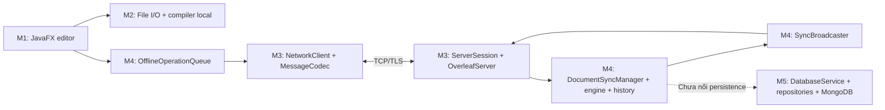

# Overleaf Desktop — Pure Java

Ứng dụng soạn thảo LaTeX desktop theo mô hình client/server, sử dụng JavaFX cho giao diện, Java TCP/TLS cho kết nối, xử lý cộng tác trong Java và module MongoDB riêng. Dự án gồm **4 Maven module**, chia công việc cho **5 member**.

Tài liệu cập nhật ngày **01/11/2026**, mô tả source hiện có trong workspace. Cột member thể hiện trách nhiệm theo phân công và phần tích hợp đã thực hiện, không phải xác nhận tác giả Git của từng dòng code.

Hợp đồng tích hợp mới nhất: [SYNC_PROTOCOL.md](SYNC_PROTOCOL.md). Wire v2 bổ sung clock snapshot, RESYNC nhiều frame và ACK_BATCH; cần cập nhật cả client/server cùng phiên bản. Các tài liệu Markdown đang bị xóa trong working tree của người dùng không được tự khôi phục trong lần sửa code này.

## 1. Phân công thành viên

| Member | Vai trò | Thư mục/phần việc chính |
| --- | --- | --- |
| **M1** | GUI & Client | `overleaf-client/.../gui/`, `ClientApp.java`, theme JavaFX; nối sự kiện editor với compiler, file manager và collaboration |
| **M2** | Core Compiler Engine & I/O | `overleaf-client/.../compiler/`, `overleaf-client/.../io/`; compile local, quản lý file và watcher |
| **M3** | Networking Backend | `overleaf-server/.../server/` ngoài package `collaboration`, `overleaf-client/.../net/`, codec/TLS trong Common; build/deploy server |
| **M4** | Collaboration Logic | `overleaf-server/.../collaboration/`, model/operation/offline queue trong `overleaf-common/.../sync/` |
| **M5** | Database & Testing | `database/`: model, repository, service MongoDB và test database; test networking/M4/IO do phần tương ứng quản lý |

## 2. Trạng thái hiện tại

- Có server TCP/TLS chạy bằng JAR, AUTH bằng token chung, quản lý session/phòng, heartbeat, timeout và broadcast qua M4.
- Có GUI JavaFX dùng transport M3, thao tác chỉnh sửa M4, danh sách thành viên, JOIN và reconnect/RESYNC.
- Có compiler local, quản lý file, watcher và module database riêng.
- **Chưa nối MongoDB với luồng lưu tài liệu của server**; nội dung và lịch sử phòng ở RAM, mất khi restart server.
- Token chung chưa phải đăng nhập tài khoản hoặc phân quyền theo project. Queue offline của client cũng ở RAM.
- Canvas preview hiện vẽ từ nội dung LaTeX; chưa phải renderer đọc PDF đầu ra. Bản Swing cũ chưa dùng networking mới.
- Dự án hiện không có Next.js/Tailwind; đây mới là phương án đã thảo luận.

## 3. Cấu trúc thư mục

```text
Overleaf-app/
├── pom.xml                       # Maven parent, khai báo 4 module
├── overleaf-common/              # Model, payload, wire protocol dùng chung
│   └── src/
│       ├── main/java/com/overleaf/common/sync/
│       └── test/java/com/overleaf/common/sync/
├── overleaf-client/              # Desktop: GUI, compiler, file I/O, TCP client
│   └── src/
│       ├── main/java/com/overleaf/client/
│       │   ├── gui/
│       │   ├── compiler/
│       │   ├── io/
│       │   └── net/
│       ├── main/resources/styles/
│       └── test/java/com/overleaf/client/
├── overleaf-server/              # TCP backend và collaboration engine
│   └── src/
│       ├── main/java/com/overleaf/server/
│       │   └── collaboration/
│       └── test/java/com/overleaf/server/
│           └── collaboration/
├── database/                     # MongoDB, repository và service
│   └── src/
│       ├── main/java/com/overleaf/db/
│       │   ├── config/
│       │   ├── model/
│       │   ├── repository/impl/
│       │   └── service/
│       ├── main/resources/
│       └── test/java/com/overleaf/db/repository/
├── deploy/                       # Mẫu env và service Linux
├── tools/                        # Launcher JUnit dùng cho script test
├── dist/                         # JAR networking được sinh khi build
├── target/                       # Cache, output networking, log và backup local
└── *.md, *.ps1, *.sh, *.bat       # Tài liệu và lệnh build/run/test
```

Trong mỗi Maven module: `src/main/java` chứa source, `src/main/resources` chứa tài nguyên runtime, `src/test/java` chứa kiểm thử và `target/` chứa output Maven. `main`/`test` trong đường dẫn thư mục là quy ước Maven, không phải tên nhánh Git.

Các bảng dưới liệt kê file source, cấu hình, script và tài liệu đang có. File sinh tự động như từng `.class`, JAR dependency hoặc report XML được mô tả theo nhóm ở mục 10.

## 4. overleaf-common — Hợp đồng chung cho client/server

`overleaf-common/pom.xml` khai báo module Common và dependency JUnit test. Source nằm trong `src/main/java/com/overleaf/common/sync/`.

| File | Chức năng | Member |
| --- | --- | --- |
| `MessageType.java` | Enum JOIN/LEAVE, TEXT_EDIT, FULL_SYNC, ACK, RESYNC, CHECKPOINT, cursor, presence, heartbeat, error và AUTH | M4 tạo hợp đồng collaboration; M3 thêm AUTH |
| `SyncMessage.java` | Envelope bất biến: type, room, sender ID/name, payload, timestamp; các factory tạo message | M4; M3 sử dụng cho transport |
| `MessageCodec.java` | Mã hóa/đọc frame nhị phân có tiền tố độ dài, giới hạn 1 MiB và kiểm tra UTF-8/version/type | M3 |
| `ResyncTransfer.java` | Chia upload offline lớn thành nhiều frame, ghép đủ rồi mới giao một RESYNC cho M4; giới hạn 4 MiB | M3/M4 |
| `TlsContexts.java` | Nạp PKCS12 keystore/truststore và tạo SSLContext từ cấu hình ngoài JAR | M3 |
| `CRDTOperation.java` | Mô tả insert/delete, operation ID, vị trí, nội dung, user và Lamport timestamp | M4 |
| `DocumentState.java` | Nội dung tài liệu, version và thao tác thay đổi nội dung trong RAM | M4 |
| `CollaboratorInfo.java` | Thông tin người tham gia, vai trò HOST/EDITOR/VIEWER, trạng thái và thời gian hoạt động | M4 |
| `CursorPosition.java` | Model vị trí con trỏ, user, tên file và thời gian cập nhật; việc hiển thị cần GUI xử lý | M4 |
| `OperationCodec.java` | Encode/decode JSON của operation và payload RESYNC gồm checkpoint/pending ops | M4 |
| `OfflineOperationQueue.java` | Giữ thao tác chưa ACK, trạng thái online/resync và last-seen operation; chưa lưu xuống đĩa | M4; M3 sửa trạng thái online sau CHECKPOINT |

Test: `src/test/java/com/overleaf/common/sync/MessageCodecTest.java` kiểm tra codec, dữ liệu sai và chuyển queue sang online sau JOIN/CHECKPOINT — **M3**.

`src/test/java/com/overleaf/common/sync/ResyncTransferTest.java` kiểm tra ghép upload, Unicode ở ranh giới chunk, giới hạn và batch ACK — **M3/M4**.

## 5. overleaf-client — Desktop client

`overleaf-client/pom.xml` cấu hình Common, JavaFX và JUnit; dependency Server chỉ ở **test scope** để kiểm tra hai đầu. GUI là phần M1; compiler/I/O là M2; transport là M3 và logic pending ops là M4.

### 5.1 Source Java

Đường dẫn gốc: `src/main/java/com/overleaf/client/`.

| File tương đối | Chức năng | Member |
| --- | --- | --- |
| `ClientApp.java` | Main desktop, mặc định JavaFX; `--swing` chọn bản Swing cũ | M1 |
| `gui/OverleafFxApp.java` | Editor, cây file, menu, chọn compiler, log, Canvas preview; tích hợp file I/O, queue offline, xử lý remote edits và hộp thoại kết nối | M1 xây GUI/tích hợp; M3 nối NetworkClient, token/TLS và presence thật; dùng M2/M4 |
| `gui/OverleafDesktopApp.java` | Giao diện Swing dự phòng từ phiên bản trước | M1 |
| `compiler/LatexCompilerService.java` | Chạy compiler bằng ProcessBuilder nền, engine, timeout, log, phân tích lỗi và callback | M2 |
| `io/ProjectFileManager.java` | Đọc/ghi/tạo/xóa/đổi tên file, liệt kê tài liệu, định vị PDF và nhận biết own-write | M2 |
| `io/WorkspaceWatcher.java` | Theo dõi thay đổi filesystem, thông báo cho caller và dừng watcher khi đóng | M2 |
| `net/NetworkClient.java` | TCP/TLS, xác thực token, hostname verification, reader/writer, queue gửi FIFO và heartbeat | M3 |
| `net/ConnectionScope.java` | Guard theo generation/phòng để callback cũ không cập nhật phiên GUI mới | M3 |
| `net/NetworkDemo.java` | Console headless kiểm tra JOIN, insert/delete, cursor, snapshot và ACK | M3 |

### 5.2 Tài nguyên và test

| File | Chức năng | Member |
| --- | --- | --- |
| `src/main/resources/styles/overleaf-theme.css` | Theme cho các component JavaFX | M1 |
| `src/test/java/com/overleaf/client/io/ProjectFileManagerTest.java` | Test hành vi file manager | M2 |
| `src/test/java/com/overleaf/client/net/NetworkClientTest.java` | Test API transport với server thật, disconnect, token và certificate TLS/hostname | M3 |
| `src/test/java/com/overleaf/client/net/ConnectionScopeTest.java` | Regression callback cũ khi đổi phòng hoặc reconnect cùng phòng | M3 |

## 6. overleaf-server — Networking và collaboration

`overleaf-server/pom.xml` khai báo Common, Database, JUnit và Surefire. Server có dependency module Database trong Maven nhưng luồng networking hiện chưa gọi `DatabaseService`. JAR standalone do `build-network.*` tạo không đóng gói database.

### 6.1 TCP backend — M3

Đường dẫn: `src/main/java/com/overleaf/server/`.

| File | Chức năng |
| --- | --- |
| `ServerApp.java` | Main headless, đọc cấu hình, nạp TLS, khởi chạy server, shutdown hook và exit code lỗi |
| `ServerConfig.java` | Cấu hình host/port, giới hạn client/document/queue, timeout, token/TLS; kiểm tra external bind |
| `OverleafServer.java` | Accept kết nối, AUTH, membership, kiểm tra sender/op, giới hạn phòng và route message sang M4 |
| `ServerSession.java` | Adapter socket của `SyncBroadcaster.ClientSession`, reader/writer riêng, queue có giới hạn và dọn presence khi đóng |

### 6.2 Collaboration — M4, có điểm tích hợp M3

Đường dẫn: `src/main/java/com/overleaf/server/collaboration/`.

| File | Chức năng | Phần phối hợp |
| --- | --- | --- |
| `CRDTEngine.java` | Áp dụng insert/delete và biến đổi operation khi xử lý xung đột | M4 |
| `DocumentSyncManager.java` | Giữ phòng/document, JOIN/LEAVE, edit, cursor, heartbeat, snapshot/checkpoint và RESYNC | M4; M3 thêm `processMessage` đồng bộ để giữ thứ tự TCP |
| `OperationHistory.java` | Lịch sử có giới hạn, tra operation đã áp dụng, tìm phần sau checkpoint và đánh dấu lịch sử đã trim | M4 |
| `SyncBroadcaster.java` | Đăng ký session theo phòng, gửi riêng/broadcast, outbox theo session để giữ thứ tự | M4; M3 thêm capacity và disconnect khi queue đầy |
| `CollaborationThreadPool.java` | Pool xử lý sync, broadcast và scheduler; shutdown các pool | M4 |

### 6.3 Test và benchmark

Đường dẫn: `src/test/java/com/overleaf/server/`.

| File tương đối | Chức năng | Member |
| --- | --- | --- |
| `NetworkingTest.java` | Socket thật: AUTH, JOIN/edit order, room isolation, identity, cursor, timeout, limit, reconnect/RESYNC, queue và shutdown | M3 |
| `collaboration/M4CollaborationTest.java` | Các tình huống cộng tác cơ bản qua adapter giả lập | M4 |
| `collaboration/OfflineResyncTest.java` | Pending ops, ACK bị mất, offline replay và thứ tự thông điệp | M4 |
| `collaboration/M4TestSupport.java` | Môi trường và client giả dùng chung cho test M4 | M4 |
| `collaboration/BenchmarkM4.java` | Chương trình đo thử xử lý collaboration; không phải benchmark toàn bộ mạng/VPS | M4 |

## 7. database — MongoDB và persistence API

`database/pom.xml` khai báo Common, MongoDB driver, logger và JUnit. Source nằm trong `src/main/java/com/overleaf/db/`, phụ trách chính **M5**.

| File tương đối | Chức năng |
| --- | --- |
| `config/MongoDatabaseManager.java` | Đọc cấu hình, tạo MongoClient/MongoDatabase, đăng ký POJO codec và đóng kết nối |
| `model/User.java` | User: ID, username, email, password hash và danh sách project |
| `model/Project.java` | Project: tên, owner/collaborator, root document và metadata thời gian |
| `model/Document.java` | File/thư mục dự án: project ID, tên, path, content, cờ directory và thời gian |
| `repository/UserRepository.java` | Hợp đồng thao tác người dùng và liên kết project |
| `repository/ProjectRepository.java` | Hợp đồng thao tác project |
| `repository/DocumentRepository.java` | Hợp đồng thao tác document, tìm theo project/path và cập nhật nội dung |
| `repository/impl/UserRepositoryImpl.java` | Triển khai UserRepository bằng MongoDB |
| `repository/impl/ProjectRepositoryImpl.java` | Triển khai ProjectRepository bằng MongoDB |
| `repository/impl/DocumentRepositoryImpl.java` | Triển khai DocumentRepository bằng MongoDB |
| `service/DatabaseService.java` | API chung: authenticate, loadInitialDocumentContent, saveDocumentContent và getter repository |

### 7.1 Resources và test — M5

| File | Chức năng |
| --- | --- |
| `src/main/resources/config.properties.example` | Mẫu cấu hình MongoDB, dùng làm nguồn tạo cấu hình local |
| `src/main/resources/config.properties` | Cấu hình runtime local; không đưa credential vào tài liệu hoặc commit |
| `src/main/resources/simplelogger.properties` | Cấu hình log của SLF4J Simple |
| `src/test/java/com/overleaf/db/MongoConnectionTest.java` | Kiểm tra kết nối MongoDB |
| `src/test/java/com/overleaf/db/repository/UserRepositoryTest.java` | Test repository user |
| `src/test/java/com/overleaf/db/repository/ProjectRepositoryTest.java` | Test repository project |
| `src/test/java/com/overleaf/db/repository/DocumentRepositoryTest.java` | Test repository document |

Các test database cần môi trường MongoDB phù hợp. Việc có `DatabaseService` không có nghĩa server đã tự lưu tài liệu: bước gọi API này từ M3/M4 vẫn còn phải tích hợp.

## 8. deploy và tools

| File | Chức năng | Member/phụ trách |
| --- | --- | --- |
| `deploy/overleaf.service` | Mẫu systemd: chạy JAR bằng user riêng, env file, restart và shutdown | M3; người triển khai điền môi trường VPS |
| `deploy/overleaf.env.example` | Env mẫu bind loopback, phù hợp SSH tunnel | M3 |
| `deploy/overleaf-public.env.example` | Env mẫu public TCP với TLS, token và đường dẫn keystore | M3 |
| `tools/NetworkingTestLauncher.java` | Launcher chạy JUnit thật từ cache, dùng bởi script test networking | M3 |

## 9. File tại thư mục gốc

| File | Chức năng / tình trạng |
| --- | --- |
| `pom.xml` | Maven parent, module, Java 17, version dependency và plugin dùng chung |
| `.gitignore` | Bỏ qua output build, cache, artifact, credential/keystore và file LaTeX tạm |
| `main.tex` | Tài liệu LaTeX local của người dùng/client, cần giữ khi dọn dự án |
| `build-network.ps1` | M3: build server/demo bằng JDK trên Windows |
| `build-network.sh` | M3: build server/demo bằng JDK trên Linux/macOS |
| `run-server.bat` | M3: chạy server JAR, nhận port tùy chọn |
| `run-network-demo.bat` | M3: chạy client console với host, port, user ID và room |
| `test-network.ps1` | M3: build và chạy test networking/M4 với JUnit cache 5.10.2 |
| `run-client.bat` | Script JavaFX cũ của M1; chưa cập nhật để compile package `net` và dùng cache mới, không dùng làm lệnh chuẩn cho bản hiện tại |
| `run-client-swing.bat` | Script Swing cũ; luồng compile hiện tham chiếu ClientApp/JavaFX nên cần cập nhật trước khi sử dụng |
| `README.md` | Bản đồ thư mục/file, chức năng, phân công và cách chạy hiện tại |
| `SYNC_PROTOCOL.md` | Hợp đồng v2 hiện tại cho Lamport, RESYNC nhiều frame, ACK_BATCH và phiên GUI |
| `AI_Handoff.md` | Trạng thái bàn giao, lịch sử thay đổi, kết quả kiểm chứng và phần việc còn lại theo member |
| `NETWORKING_M3.md` | Hợp đồng TCP, cấu hình, API client và giới hạn networking |
| `DEPLOY_SERVER.md` | Hướng dẫn JAR, SSH tunnel, TLS public và systemd |
| `HD_CHAY_UNG_DUNG.md` | Hướng dẫn cũ; có mô tả đường dẫn/script không còn khớp, giữ làm tài liệu lịch sử |
| `overleaf_desktop_ver2.md` | Báo cáo/thiết kế Pure Java, phân công 5 member và Maven modules |
| `overleaf_desktop_ver2 (1).md` | Bản Markdown người dùng giữ lại; chưa hợp nhất với bản ver2 chính |
| `overleaf_desktop_pure_java_project_report.md` | Báo cáo thiết kế Pure Java ban đầu |
| `overleaf-desktop-blueprint.md` | Blueprint sản phẩm, gồm các phương án web; không phải mô tả đầy đủ stack đã triển khai |
| `task-m4.md` | Danh sách công việc/ghi chú M4 |
| `walkthrough-m4.md` | Giải thích triển khai, offline/resync và benchmark M4; có trạng thái lịch sử |

`build.bat` cũ và các `.gitkeep` dư đã được dọn. Không dùng đường dẫn `src/com/...` cũ để build dự án Maven này.

## 10. File sinh ra khi build/chạy

| Thư mục/file | Ý nghĩa |
| --- | --- |
| `.git/` | Metadata/lịch sử nhánh của Git |
| `dist/overleaf-server.jar` | Server headless để chuyển lên VPS |
| `dist/overleaf-network-demo.jar` | Client console độc lập để thử kết nối |
| `target/network-classes/` | Class do script build networking sinh ra |
| `target/network-test-classes/`, `target/network-test-libs/` | Class và thư viện cho script test |
| `target/maven-cache/` | Cache Maven local dùng trong các lần kiểm chứng trên máy này, gồm JavaFX dependency |
| `target/maven-compile.log`, `target/maven-network-tests.log` | Log kiểm chứng trước đó |
| `target/markdown-backup-*/`, `target/AI_Handoff.before-20261101.md` | Bản sao tài liệu đã giữ trước khi cập nhật; không tự xóa |
| `target/cleanup-*.json` | Manifest và hash dùng để kiểm tra lần dọn file |
| `<module>/target/classes/`, `test-classes/` | Output compile Maven của từng module |
| `<module>/target/surefire-reports/` | Report test JUnit/Surefire |
| `bin/` nếu xuất hiện lại | Output của script client cũ, không phải source chính |

Đây là các nhóm artifact, không phải module nghiệp vụ. Xóa cache/output cần build lại; lệnh JavaFX bên dưới đang dùng output Maven và dependency cache nên phải giữ hoặc tạo lại chúng.

## 11. Luồng phối hợp giữa member



Operation được gửi trong payload `TEXT_EDIT`. M4 áp dụng vào RAM, ACK người gửi và broadcast cho người khác. Sau mất mạng, client tạo kết nối mới rồi gửi RESYNC. Nếu server restart, phòng RAM không còn và RESYNC trả lỗi chứa `ROOM_UNKNOWN`.

## 12. Build và chạy

### 12.1 Backend + demo, không cần Maven

Cần JDK đầy đủ **17+** gồm `java`, `javac`, `jar`. Với JDK đang có trên máy Windows này:

```powershell
$env:JAVA_HOME = 'C:\Users\Admin\.jdks\ms-21.0.13.0.2'
powershell -NoProfile -ExecutionPolicy Bypass -File .\build-network.ps1
.\run-server.bat 8080
```

Hai terminal khác, đặt JAVA_HOME tương tự rồi chạy mỗi dòng ở một terminal:

```powershell
.\run-network-demo.bat 127.0.0.1 8080 alice demo
.\run-network-demo.bat 127.0.0.1 8080 bob demo
```

Nhập `/insert 0 Hello`, `/delete 0 Hello`, `/cursor 2 7` hoặc `/quit`.

Linux/macOS: `sh build-network.sh`, sau đó `java -jar dist/overleaf-server.jar`.

### 12.2 Build toàn bộ bằng Maven

Sau khi cấu hình Maven/JDK trên PATH:

```powershell
mvn compile
```

Nếu muốn dùng cache trong workspace như máy hiện tại:

```powershell
mvn "-Dmaven.repo.local=$PWD\target\maven-cache" compile
```

Maven có thể tải dependency ở lần đầu. Nếu `mvn` chưa nằm trên PATH, dùng Maven của IDE hoặc cấu hình Maven trước. JDK cần thiết cho build; server runtime không cần JavaFX hoặc TeX. Compile LaTeX thật trên client cần TeX Live/MiKTeX và compiler tương ứng.

### 12.3 Mở JavaFX sau khi Maven compile

Terminal khác với terminal đang chạy server, tại thư mục gốc dự án:

```powershell
$env:JAVA_HOME = 'C:\Users\Admin\.jdks\ms-21.0.13.0.2'
$fxRoot = '.\target\maven-cache\org\openjfx'
if (!(Test-Path $fxRoot)) { $fxRoot = "$env:USERPROFILE\.m2\repository\org\openjfx" }
$fx = (Get-ChildItem $fxRoot -Recurse -Filter '*-win.jar').FullName -join ';'
& "$env:JAVA_HOME\bin\java.exe" --module-path "$fx" --add-modules 'javafx.controls,javafx.fxml' -cp 'overleaf-common\target\classes;overleaf-client\target\classes' com.overleaf.client.ClientApp
```

Lệnh chọn dependency cache hiện tại trên Windows; nếu cache chứa nhiều phiên bản JavaFX, chỉ chọn cùng phiên bản trong POM. Trong UI: host `127.0.0.1`, port `8080`, room `demo`, token trống, TLS tắt khi server dùng mặc định. Lưu file local trước JOIN mới vì snapshot server sẽ thay nội dung editor. Chạy lại lệnh Java để mở client thứ hai.

### 12.4 Test và deploy

Test chọn lọc, không chạy test MongoDB:

```powershell
mvn "-Dtest=MessageCodecTest,ResyncTransferTest,ConnectionScopeTest,NetworkingTest,NetworkClientTest,M4CollaborationTest,OfflineResyncTest,ProjectFileManagerTest" "-Dsurefire.failIfNoSpecifiedTests=false" test
```

Kết quả sau cập nhật hợp đồng v2: **42/42 test pass**. Chi tiết phạm vi/môi trường nằm trong [AI_Handoff.md](AI_Handoff.md). `mvn test` không chọn lọc sẽ bao gồm test database và cần cấu hình MongoDB.

Triển khai lên VPS theo [DEPLOY_SERVER.md](DEPLOY_SERVER.md). Hợp đồng đồng bộ mới nhất nằm trong [SYNC_PROTOCOL.md](SYNC_PROTOCOL.md); cập nhật JAR cả hai đầu cùng phiên bản.
