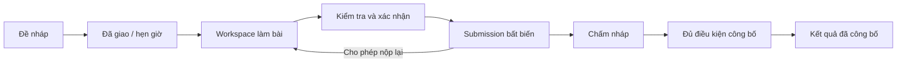

# Thiết kế Writing — giao bài, cộng tác và chấm theo tiêu chí

**Đã đổi định hướng theo phản hồi:** giao diện chính hiện tập trung IELTS Writing, không phải Research Introduction/paper. Xem [IELTS_WRITING_DESIGN.md](IELTS_WRITING_DESIGN.md) và prototype IELTS tại cùng đường dẫn cũ. Tài liệu dưới đây là thiết kế tổng quát trước, chỉ còn dùng tham khảo hạ tầng/phần mở rộng; mapping 21 màn nghiên cứu không còn là prototype đang chạy.

Ngày 07/11/2026 · Nguồn: `D:\download\Writing.pdf`, 4 trang · Sản phẩm: **Latex**.

Đây là bản thiết kế để triển khai trên nền Python + Next.js hiện có. [Bản mẫu tương tác](prototypes/writing/index.html) minh họa luồng; chưa tích hợp API, phân quyền hoặc cộng tác thật. Không coi những chức năng trong bản mẫu là đã có trên ứng dụng.

## 1. Đọc đúng ý tưởng từ PDF

| Nguồn | Yêu cầu rút ra |
| --- | --- |
| Trang 1 | Bắt đầu từ chấm IELTS Writing, mở rộng sang report/paper theo tiêu chí cho từng phần, đoạn và ý; giảng viên cho điểm; có thể tính tổng/trung bình hoặc chỉ nhận xét. |
| Trang 1 | Admin vận hành; giảng viên tạo/upload/giao bài, chọn người làm, thời gian tùy chọn, chấm từng bài. Sinh viên làm bài. Mời cộng tác bằng email, dùng template. |
| Trang 2, GV01–GV08 | Writing nằm trong workspace; danh sách bài, wizard tạo bài, bộ tiêu chí phân cấp, danh sách bài nộp, màn hình chấm ba cột và phiếu chấm. Lưu nháp khác công bố. |
| Trang 3, SV01–SV08 | Bài được giao → yêu cầu → viết nhóm → kiểm tra → xác nhận nộp → lịch sử → kết quả → phản hồi chi tiết. Chỉ xem điểm đã công bố. |
| Trang 4, SV-W01–SV-W04 | Chọn viết văn bản hoặc LaTeX; góp ý theo đoạn; văn bản → xem trước LaTeX → xác nhận → compile PDF. Không tự đồng bộ hai chiều Văn bản ↔ LaTeX. |

Các phần dưới như kiểm quyền chi tiết, snapshot bất biến, MongoDB, worker và Admin UI là **đề xuất kỹ thuật bổ sung** để thực hiện đúng luồng trên web, không phải nội dung nguyên văn của PDF. Chấm thủ công theo rubric là chức năng chính; AI chấm điểm không phải yêu cầu bắt buộc.

## 2. Cấu trúc sản phẩm

Giữ ứng dụng Latex hiện có và thêm một vùng Writing, không xây một hệ thống tách rời:

```text
Latex / Không gian làm việc / Dự án
  Editor                              LaTeX, cây tệp, outline, PDF/Word
  Writing
    Giảng viên: Bài tập · Bộ tiêu chí
    Sinh viên: Bài được giao · Kết quả
  Review                              Góp ý theo đoạn/tệp
  Chat                                Tin nhắn theo phạm vi nhóm

Admin / Vận hành                       Tài khoản, vai trò, dung lượng, job, audit
```

Vai trò hiển thị do server quyết định. Prototype có công tắc vai trò chỉ để duyệt thiết kế; ứng dụng thật không có quyền tự chuyển thành giảng viên/Admin. Giao diện thống nhất tiếng Việt; tài liệu bài làm có thể bằng tiếng Anh.

### Quyết định về không gian dữ liệu

- Một lớp/học phần có nhiều bài tập. Bài tập là **đề bài + rubric + người được giao + chính sách nộp**.
- Một bài tập có nhiều workspaces làm bài: một workspace cho một cá nhân hoặc một nhóm. Không dùng chung một project cho cả lớp vì sinh viên sẽ nhìn thấy bài của nhau.
- Giảng viên sở hữu project đề/template; hệ thống tạo project làm bài riêng theo assignment và assignee. Nhiều thành viên cùng nhóm cùng sửa project nhóm.
- Project riêng ngoài lớp vẫn sử dụng editor hiện tại. Mời vào project cá nhân không tự tạo quyền xem/chấm bài của lớp.
- Sinh viên xem yêu cầu và rubric được công khai; không xem điểm/nhận xét nội bộ chưa công bố hoặc bài nhóm khác.

## 3. Vai trò và quyền

| Hành động | Admin | Giảng viên được phân công | Sinh viên/thành viên nhóm |
| --- | --- | --- | --- |
| Quản lý người dùng, cấp vai trò | Có, có audit | Không | Không |
| Tạo/sửa/giao bài, đặt hạn | Theo quyền hỗ trợ được ghi nhận | Trong lớp mình quản lý | Không |
| Tạo và version rubric | Theo quyền quản trị | Có | Xem bản gắn với bài được giao |
| Viết bài | Project được cấp quyền | Template hoặc project được mời | Project bản thân/nhóm |
| Mời người khác | Theo phạm vi | Mời lớp/nhóm, đồng giảng viên | Chỉ nhóm/project mình nếu bài cho phép |
| Nộp bài | Không nộp thay mặc định | Không sửa bài đã nộp | Người có quyền nộp của nhóm |
| Chấm và công bố | Không tự thay giảng viên | Người chấm được chỉ định | Không |
| Xem điểm | Có lý do hỗ trợ và audit | Bài được phân chấm | Chỉ kết quả đã công bố của mình/nhóm |

`Admin`, `teacher`, `student` là vai trò tài khoản/tổ chức; quyền `owner/editor/commenter/viewer/grader` theo resource. Teacher ở lớp A không có quyền lớp B. Mỗi API và WebSocket kiểm user + membership + trạng thái bài, không chỉ ẩn nút frontend. Admin vận hành không mặc nhiên đọc mọi bài riêng.

## 4. Thiết kế giao diện chung

**Điều chỉnh theo phản hồi ngày 07/11/2026:** prototype phải bám workspace hiện có thay vì trông như dashboard mới. Màu/phông lấy theo token của `apps/frontend/app/globals.css`; header 42px, rail icon nền `#1c252f` rộng 46px, sidebar chuẩn 270px, statusbar khoảng 25px. Giữ logo lá + Latex, nút Lịch sử/Cộng tác/Bố cục, tab main.tex/main.pdf/main.docx, toolbar editor tối, Build output và PDF preview. Các màn Writing thay vùng nội dung trong khung này. Thu gọn tiêu đề, bỏ thẻ thống kê lớn ở màn danh sách, giảm bo góc và khoảng trống. Prototype mở GV01 để người xem nhận ra editor trước khi bấm Writing; có Sáng/Tối và điều khiển demo gọn ở footer. Các mô tả chung bên dưới tuân theo các tỷ lệ cập nhật này.

- Màu nền giấy nhạt, xanh lá cho hành động chính; trung tính cho khung cố định như sơ đồ PDF. Cỡ chữ điều khiển 14–16px, nội dung bài 16–18px.
- Thanh trên: Latex · tên project/bài · chuyển Editor/Writing · thông báo · hồ sơ.
- Rail trái 46px: Tệp, Review, Chat, Writing. Khi ở Writing, panel kế bên là menu theo vai trò; vị trí không nhảy khi chuyển màn hình.
- Header nội dung: breadcrumb, tên bài, nhóm, trạng thái, hạn nộp và trạng thái lưu. Hành động chính nằm cố định góc phải.
- Màn hình làm bài: đề/rubric có thể thu gọn bên trái; editor ở giữa; preview hoặc góp ý bên phải. Panel kéo rộng/thu được; trạng thái lưu có `Đang lưu / Đã lưu / Lưu thất bại`.
- Màn chấm: danh sách bài nộp trái, tài liệu snapshot giữa, cây rubric/phản hồi phải. Không chuyển sang bản live của sinh viên khi chấm.
- Màn hình hẹp: danh sách và rubric thành drawer/tab; giữ nút quay lại, không ép ba cột. Focus mode có Esc và nút thoát; focus trapping chỉ trong dialog.
- Nút có nhãn/tooltip, trạng thái không chỉ biểu thị bằng màu; keyboard focus rõ; lỗi nộp/compile mô tả bằng chữ. Đổi bài khi có bản nháp chưa lưu cần flush hoặc cảnh báo.

## 5. Các màn giảng viên — bám GV01–GV08

| Mã | Nội dung | Hành động và kết quả |
| --- | --- | --- |
| GV01 | Writing trong editor, project/template hiện hành | Mở Bài tập hoặc Tạo bài tập. Editor hiện có vẫn giữ buffer và layout. |
| GV02 | Danh sách: tên, loại, lớp/nhóm, đã nộp, đã chấm, hạn, trạng thái | Tìm/lọc; tạo; mở chi tiết; nhân bản; lưu trữ. Xóa draft hoặc archive bài có submission, không xóa lịch sử im lặng. |
| GV03 | Wizard bước 1–3: nội dung, tiêu chí, người tham gia | Nhập đề bằng editor hoặc upload; chọn IELTS/report/research/custom; chọn viết một phần/nhiều phần/cả bài; chọn template; chọn cá nhân/nhóm. Lưu nháp bất cứ bước hợp lệ. |
| GV04 | Wizard bước 4: công bố đề | Chọn giờ mở, hạn tùy chọn, thời lượng tùy chọn, số lần nộp, nộp muộn, định dạng được nhận; xem tóm tắt → xác nhận Giao bài. |
| GV05 | Bộ tiêu chí: cây trái, hướng dẫn/mức đánh giá phải | Thêm nhóm/tiêu chí/checkpoint; điểm tối đa/trọng số; hướng dẫn; minh chứng; mô tả từng mức; preview; lưu version mới. |
| GV06 | Chi tiết bài: Bài nộp / Đề bài / Tiêu chí / Người tham gia | Mỗi dòng là cá nhân/nhóm, lần nộp, thời gian, muộn/đúng hạn, trạng thái chấm. Chỉ mở nút Chấm khi có submission hợp lệ. |
| GV07 | Màn hình chấm ba cột | Chọn bài; đọc PDF/văn bản/LaTeX snapshot; chọn tiêu chí; nhập điểm/nhận xét, gắn đoạn minh chứng; lưu nháp, chuyển bài, xem phiếu. |
| GV08 | Phiếu chấm | Metadata người/nhóm, attempt, người chấm, rubric version; bảng tiêu chí; tổng tùy chế độ; nhận xét. Tạo PDF; xác nhận công bố một hoặc nhiều phiếu đã đủ điều kiện. |

### Wizard chi tiết

1. **Nội dung:** tiêu đề, mục tiêu, mô tả, file đính kèm, loại bài, phần cần viết, ngôn ngữ, giới hạn từ. Tài liệu upload đề không tự trở thành bài làm sinh viên.
2. **Tiêu chí:** chọn mẫu hoặc tự tạo; sửa trong nhánh cấu hình GV05 rồi quay lại wizard đúng bước; hiển thị tổng điểm/trọng số và các trường còn thiếu.
3. **Người tham gia:** chọn lớp, cá nhân hoặc nhóm; số thành viên; phân công người chấm; quyền mời. Email chưa có tài khoản ở trạng thái Chờ chấp nhận.
4. **Công bố:** giờ mở/hạn/thời lượng, định dạng, nộp lại, nộp muộn, template; kiểm tra và giao. Sửa đề sau khi giao tạo version và thông báo; không thay rubric gắn với attempt đã bắt đầu.

## 6. Các màn sinh viên — bám SV01–SV08

| Mã | Nội dung | Hành động và kết quả |
| --- | --- | --- |
| SV01 | Writing trong editor | Tên bài, nhóm và trạng thái; mở Bài được giao hoặc tiếp tục làm. |
| SV02 | Danh sách theo Cần làm / Đã nộp / Đã chấm | Đã chấm chỉ hiện kết quả đã công bố; thẻ hiển thị hạn, nhóm và tiến độ cá nhân. |
| SV03 | Đề bài / Tiêu chí / Tài liệu | Đọc yêu cầu, phần cần viết, policy và rubric; Bắt đầu/tiếp tục. Bài có thời lượng phải xác nhận trước khi đồng hồ server bắt đầu. |
| SV04 | Workspace làm bài | Văn bản hoặc LaTeX, người đang tham gia, autosave, review, lịch sử, thời gian còn lại; Kiểm tra và nộp. |
| SV05 | Kiểm tra trước nộp | Xem đúng artifact dự kiến nộp, tên root/file, số từ, các phần bắt buộc, lưu/compile freshness; xác nhận lần cuối. Kiểm tra máy không thay điểm giảng viên. |
| SV06 | Đã nộp và lịch sử | Submission ID, attempt, thời gian server, snapshot chỉ đọc; Xem bản nộp, Về editor, Sửa và nộp lại nếu policy cho phép. |
| SV07 | Kết quả | Chỉ liệt kê phiếu đã công bố; có người chấm, ngày, điểm hoặc trạng thái chỉ nhận xét. |
| SV08 | Phản hồi chi tiết | Bản nộp cũ + điểm từng tiêu chí + minh chứng/comment đã công bố; tải phiếu PDF; quay lại danh sách. |

### Viết văn bản / LaTeX — bám SV-W01–SV-W04

- **SV-W01:** chọn Văn bản, LaTeX hoặc xem PDF. Văn bản là structured rich-text document riêng, không dùng bản DOCX chuyển từ PDF làm nguồn biên soạn chính.
- **SV-W02:** chọn đoạn → nhận xét, reply, resolve. Con trỏ/comment anchor gắn document version và vị trí có thể ánh xạ; khi không còn đoạn gốc thì hiện trích dẫn và trạng thái cần định vị lại.
- **SV-W03:** bấm Chuyển sang LaTeX → so sánh văn bản và source sinh ra; chọn template/root; liệt kê phần không chuyển được → xác nhận tạo file mới. Mặc định không ghi đè main.tex; nếu chọn ghi đè phải có backup và xác nhận.
- **SV-W04:** chuyển sang source đã tạo, compile, kiểm PDF rồi nộp. Bài cho phép chỉ nộp văn bản có thể bỏ qua bước LaTeX/PDF; policy được công bố từ đầu.
- Sau chuyển đổi, rich-text và LaTeX là hai nhánh có nguồn gốc chung; không hứa round-trip tự động. Chỉnh source không tự cập nhật văn bản cũ. Chuyển lại phải báo có thay đổi và tạo phiên bản mới.
- Giữ Word preview/export hiện có như chức năng tài liệu độc lập; DOCX không thay thế rich-text schema hoặc submission snapshot.

## 7. Rubric phân cấp và cách tính điểm

```text
Bài nghiên cứu (container)
  Introduction (container)
    Bối cảnh nghiên cứu (criterion, tối đa 2)
      Dẫn nhập vấn đề; xác định lĩnh vực; minh chứng phù hợp (checkpoints)
    Khoảng trống (criterion, tối đa 4)
      Nêu hạn chế; dẫn nguồn; lý giải nhu cầu nghiên cứu (checkpoints)
    Mục tiêu/đóng góp (criterion, tối đa 4)
      Câu hỏi rõ; phù hợp khoảng trống; mô tả đóng góp (checkpoints)
  Discussion (container, chỉ thêm nếu nằm trong phạm vi bài)
```

`container` nhóm các nút, `criterion` là lá tính điểm, `checkpoint` là kiểm tra/nhận xét không cộng điểm riêng. Nếu muốn chấm một checkpoint thành điểm, chuyển thành criterion con và biến criterion cha thành container. Không cộng đồng thời điểm cha và con.

Mỗi criterion: ID ổn định, tên, hướng dẫn cho người chấm/người viết, mô tả các mức, maxScore, weight nếu dùng, required, cho phép N/A, yêu cầu minh chứng/nhận xét, áp dụng theo phần. Hướng dẫn câu mở đầu/câu thứ hai là gợi ý theo rubric, không ép mọi paper dùng cùng cấu trúc câu.

| Chế độ | Quy tắc |
| --- | --- |
| Chỉ nhận xét | Không tạo điểm 0 hoặc tổng giả; vẫn kiểm đủ nhận xét bắt buộc. |
| Tổng điểm | `T = Σscore_i`; điểm tối đa là tổng max của các lá hợp lệ. |
| Trung bình chuẩn hóa | `T = S × mean(score_i / max_i)`; chỉ trung bình trực tiếp khi các tiêu chí cùng thang. |
| Trọng số | `T = S × Σ(w_i × score_i/max_i) / Σw_i`, với các lá áp dụng; trọng số cùng một cấp tính, không trộn trọng số nhóm và lá. |
| IELTS | Profile riêng; lưu điểm gốc và quy tắc làm tròn được chọn/version; không ép rubric nghiên cứu dùng band IELTS. |

`null` là chưa chấm, khác điểm 0. Không hiển thị tổng như kết quả cuối khi thiếu criterion required; có thể hiện tạm tính có nhãn rõ. N/A chỉ khi rubric cho phép, bắt buộc lý do; loại cả điểm và phần mẫu số tương ứng. Làm tròn ở bước kết quả cuối theo policy; dùng Decimal. Phiếu lưu công thức, đầu vào và kết quả để tái lập.

Mẫu IELTS dùng TA (Task 1)/TR (Task 2), CC, LR, GRA. Task 2 có trọng số lớn hơn Task 1 khi tổng hợp hai task; không cộng hai task nếu bài tập chỉ giao một task. Nội dung chấm ở đây là đánh giá học tập, không tự nhận là kết quả thi chính thức. [Nguồn IELTS về Writing](https://ielts.org/take-a-test/test-types/ielts-academic-test/ielts-academic-format-writing).

### Hạn chế thiên lệch khi chấm

Rubric có mô tả mức và ví dụ chuẩn; tùy chọn ẩn danh khi chấm; ghi minh chứng theo tiêu chí; cảnh báo chưa nhận xét các điểm thấp theo policy; có thể chấm theo một tiêu chí qua nhiều bài. Chấm lần hai/moderation là phần mở rộng. Không tuyên bố checklist loại bỏ được cảm xúc hoặc bảo đảm công bằng tuyệt đối.

## 8. Trạng thái và quy tắc không được phá



- Assignment: `draft/scheduled/open/closed/archived`. Đóng nhận bài khác với kết thúc chấm; archived không xóa snapshot.
- Workspace: `not_started/in_progress`; trạng thái nộp và kết quả lấy từ attempts/assessments riêng, không gộp thành một cờ.
- Submission: bản ghi bất biến `attemptNo`, `submittedAt`, `late`, `sourceRevision`, manifest, artifact hash, rubricVersion. Bản nộp lại tạo attempt mới, bản cũ vẫn đọc được.
- Assessment: `draft/ready/published`, gắn đúng submission. Sửa điểm đã công bố tạo revision mới, yêu cầu lý do và audit; bản công bố cũ được lưu.
- Thời gian UTC lưu ở server, UI hiện múi giờ lớp. Nếu có cả hạn và thời lượng: `effectiveDueAt = min(assignmentDueAt, startedAt + duration)` sau khi áp dụng extension hợp lệ; trường không đặt thì bỏ khỏi phép min.
- Nhóm chỉ có một attempt đang mở, thời điểm bắt đầu chung khi thành viên đầu tiên xác nhận; phải hiện rõ trước khi bắt đầu. IELTS luyện cá nhân là mặc định, nhóm dùng cho report/paper theo bài.
- Nút nộp cần `Idempotency-Key` và expected revision; hai người nhóm nộp đồng thời chỉ tạo một attempt cho cùng request nghiệp vụ. Chỉ báo nộp thành công sau server ACK và có receipt.
- Nộp PDF bắt buộc snapshot compile thành công và đúng revision. Không lấy PDF cũ sau khi sửa source hoặc compile lỗi. Bản nộp không tham chiếu cache tạm có thể bị clean.
- Hết giờ không tự tạo bài nộp từ dữ liệu chưa đồng bộ trên browser. Nếu bật auto-submit, phải công bố policy trước và chỉ dùng revision đã lưu ở server; mất mạng được thông báo, retry không giả thành công.
- Kết quả chưa publish: API sinh viên không trả điểm, tổng, nhận xét người chấm hoặc URL artifact chấm; không chỉ che bằng CSS. Draft review giữa thành viên tách khỏi feedback chấm riêng của giảng viên.
- Thay rubric sau giao bài tạo version, không đổi điểm/bản nộp trước đó. Đề mới có thể được thông báo; rubric khác cần quy trình nhân bản bài hoặc đồng thuận chuyển version cho attempts chưa bắt đầu.

## 9. Mời email và cộng tác

Giảng viên mời theo lớp, nhóm hoặc project với quyền rõ ràng. Sinh viên chỉ mời khi assignment cho phép và trong giới hạn nhóm; không mời vào nhóm khác hoặc tự cấp grader. Link mời dùng token ngẫu nhiên, DB lưu hash, có hạn, dùng một lần, email được xác minh; không tự gán quyền chỉ vì biết địa chỉ email.

WebSocket phải xác thực session, membership và từng document room. Góp ý và chat có phạm vi riêng; mặc định chat nhóm không hiện cho nhóm khác. Reconnect lấy snapshot/update được quyền truy cập. Thu hồi membership phải ngắt kết nối đang mở. Nhóm/bài đã nộp vẫn có thể sửa working copy theo policy, không sửa submission cũ.

CRDT cho source/rich-text là giai đoạn riêng; không gọi networking TCP/TLS hiện có là cộng tác web đã sẵn sàng. Yjs có bindings cho CodeMirror và ProseMirror; lựa chọn này phù hợp hướng editor hiện tại. [Tài liệu Yjs](https://docs.yjs.dev/ecosystem/editor-bindings). FastAPI hỗ trợ WebSocket nhưng vẫn cần tự thiết kế phân quyền/persistence/fan-out; ví dụ connection manager in-memory không thay hệ thống nhiều worker. [Tài liệu FastAPI](https://fastapi.tiangolo.com/advanced/websockets/).

## 10. Đối chiếu code hiện có

| Có thể dùng lại | Cần bổ sung/thay đổi |
| --- | --- |
| CodeMirror, nhiều tab/root, file tree/outline | Writing shell, assignment navigation và role-aware UI |
| Compile, PDF snapshot, stale/export guard, SyncTeX | Submission snapshot bền vững và worker theo project/user |
| Word preview + converter PDF→DOCX | Rich-text authoring schema riêng và bước chuyển sang LaTeX |
| Review/comment theo file trong `collaboration/review.py` | Anchor theo version, scope draft/grader/published, quyền và cộng tác |
| `documents/ielts.py`, `IeltsGradingPanel.tsx` | Validate schema, rubric đa loại, server calculation, chấm theo submission |
| Server-managed Store, history | Project ownership/membership và cô lập workspace theo assignee |
| `storage/persistence.py` có repository prototype | Mongo wiring thực tế, indexes/migration, repository cho nghiệp vụ |
| TCP/TLS networking | WebSocket, CRDT, durable document updates, membership checks |

Đặc biệt: IELTS manager hiện lưu một JSON theo project và có dữ liệu/điểm mặc định. Không dùng điểm mặc định đó làm điểm thật cho bài mới; bài chưa chấm phải `null`. Module hiện tại chưa cung cấp assignment, lần nộp hoặc publish-gating. Account/session hiện dùng state chung process, phải thay trước khi có lớp nhiều người.

## 11. Kiến trúc triển khai đề xuất

```text
Next.js UI → FastAPI (auth + membership + application services)
                 ├→ MongoDB: users/classes/assignments/rubrics/submissions/grades
                 ├→ Artifact store: source revisions, assets, immutable PDF/DOCX
                 ├→ Job queue → isolated TeX/conversion workers
                 └→ WebSocket rooms → durable document updates + fan-out
```

Giữ modular monolith, bổ sung các nhóm nghiệp vụ khi bắt đầu triển khai:

```text
apps/backend/src/latex_backend/
  identity/          users, sessions, invitations, resource permissions
  education/         classes, groups, assignments, policies, services
  assessment/        rubric schema/version, scoring, grading, publish
  submissions/       attempts, snapshot manifest, validation, receipt
  collaboration/     rooms, documents, anchors, review, chat
  documents/         rich-text schema, conversion, existing Word services
  jobs/              compile/export orchestration, worker adapters
  http/routers/      auth, classes, assignments, rubrics, submissions, grades
  storage/           existing store + Mongo repositories + artifact interface
  core/              config, composition, error handling

apps/frontend/
  features/writing/  shell, assignments, student workbench, rubric, grading
  features/admin/    role management, job/storage views
  lib/               authenticated API, event client, typed contracts
```

Không tạo sẵn hàng loạt folder rỗng trong đợt thiết kế. Route UI có thể dùng state/hash trên static export hiện có ở giai đoạn đầu; nếu chọn server-rendered dynamic routes phải đổi cấu hình Next/deploy có kiểm thử riêng. FastAPI tiếp tục là chủ dữ liệu/quyền.

### Thư viện và hạ tầng

- Giữ Next.js/React/CodeMirror/PDF.js và pipeline PDF/Word đang hoạt động.
- Rich-text đề xuất ProseMirror/Tiptap với schema heading/paragraph/list/table/image/math; chọn extension và giấy phép khi triển khai, không mặc định mọi extension thương mại đều miễn phí. Chuyển LaTeX theo AST có allowlist; giữ asset manifest và cảnh báo node không hỗ trợ.
- MongoDB cho metadata, snapshot manifest và grading; binary dùng filesystem volume bền vững trước, artifact interface hỗ trợ object storage sau. PyMongo đã có trong project; async handlers mới có thể dùng PyMongo Async, không thêm Motor cho thiết kế mới. [Tài liệu MongoDB](https://www.mongodb.com/docs/languages/python/pymongo-driver/current/reference/migration/).
- Redis + một worker queue được chọn khi triển khai (ví dụ Celery) cho compile/export, retry và broadcast; không xem Redis là nơi lưu duy nhất của submission/điểm. TeX worker không giữ session hay chạy trong request web.
- Yjs ở browser, Python room service tương thích qua adapter cần spike kiểm chứng. Không thêm CRDT package chỉ vì tên phù hợp; phải test persistence/reconnect với CodeMirror và rich-text trước chốt thư viện Python.
- Người dùng web không cung cấp đường dẫn server/executable. Compile trong sandbox riêng, tài nguyên/time/network hạn chế, không chạy shell escape tùy ý. Secret không nằm trong frontend.

## 12. Mô hình dữ liệu MongoDB

Mọi ID được validate, truy vấn luôn có scope workspace/class/project. Version integer dùng optimistic concurrency. Thời gian UTC; thang điểm Decimal128 hoặc decimal string được validate.

| Collection | Nội dung chính | Ràng buộc/index |
| --- | --- | --- |
| users, sessions | Email chuẩn hóa, password hash, role; session hash/expiry | unique email; TTL session expiry; session theo user/browser |
| classes, memberships | Học phần, instructor; resource/type/user/role/status | unique `(resourceType, resourceId, userId)` |
| invitations | Email, scope, role được mời, token hash, expiry, acceptedAt | unique tokenHash; kiểm expiry ở application dù TTL chưa xóa |
| groups, group_members | Class, assignment, member list, quyền nộp | unique membership; giới hạn nhóm theo policy |
| rubrics, rubric_versions | Owner, cây tiêu chí, scoring mode/formula | unique `(rubricId, version)`; version được dùng thì immutable |
| assignments | Class, đề revision, rubricVersion, timing, policy, assignees | index class/status/dueAt; lockVersion |
| workspaces | Assignment, assigneeType/id, projectId, startedAt, currentRevision | unique `(assignmentId, assigneeType, assigneeId)` |
| document_revisions | Rich-text/source revision, artifact manifest, hash | immutable; index project/document/version |
| submissions | Workspace, attemptNo, receipt, artifact IDs/hash, rubricVersion | unique `(workspaceId, attemptNo)` và idempotency scope |
| assessments, assessment_revisions | Submission, grader, criterion scores, evidence, feedback, status | unique revision; publishedRevisionId trỏ bản công bố |
| threads, chat_messages | Project/document/revision, scope, participants, content | index project/scope/time; kiểm membership khi đọc |
| artifacts, jobs, audit_events | Storage keys/hash/size; job state; hành vi nhạy cảm | không trả filesystem path; job owner/scope index |

Submission và grade là record riêng, không nhét tất cả vào một JSON project hoặc một document Mongo ngày càng lớn. Publish dùng compare-and-set hoặc transaction với outbox; thông báo phát sau commit. Worker: ghi artifact content-addressed trước, commit manifest sau; job lỗi không tạo submission thành công. Orphan artifact có job dọn có retention và không xóa reference đang dùng.

### Ví dụ bản nộp và bài chấm

```json
{
  "submission": {
    "id": "submission-02", "workspaceId": "workspace-group-02",
    "attemptNo": 2, "sourceRevision": "rev-41", "rubricVersionId": "rubric-intro-v3",
    "format": "pdf", "artifacts": [{"id": "artifact-pdf-41", "sha256": "<sha256>", "kind": "pdf"}],
    "submittedAt": "2026-11-07T10:00:00Z", "late": false
  },
  "assessment": {
    "submissionId": "submission-02", "status": "draft", "version": 1,
    "scores": [{"criterionId": "background", "value": 1.5, "max": 2, "evidence": "anchor-12"}],
    "overallFeedback": "Cần làm rõ khoảng trống nghiên cứu.", "publishedRevisionId": null
  }
}
```

## 13. API và events cần triển khai

Prefix `/api/v1`; API cũ giữ trong giai đoạn chuyển đổi, adapter kiểm quyền áp dụng cho cả route cũ để không có đường đi tắt.

| Nhóm | Endpoints chính |
| --- | --- |
| Identity | `POST /auth/login`, `/auth/logout`; `GET /me`; `POST /invitations`, `/invitations/accept` |
| Lớp/nhóm | `GET/POST /classes`; `GET/PATCH /classes/{id}`; `/classes/{id}/members`, `/groups` |
| Đề bài | `GET/POST /assignments`; `GET/PATCH /assignments/{id}`; `POST /assignments/{id}/publish` |
| Rubric | `GET/POST /rubrics`; `POST /rubrics/{id}/versions`; `GET /rubric-versions/{id}` |
| Làm bài | `POST /assignments/{id}/start`; `GET /workspaces/{id}`; save revision theo quyền |
| Chuyển đổi | `POST /workspaces/{id}/conversions`; `GET /conversions/{id}`; `POST /conversions/{id}/confirm` |
| Nộp bài | `POST /workspaces/{id}/submission-previews`; `POST /workspaces/{id}/submissions`; `GET /submissions/{id}` |
| Chấm | `GET /assignments/{id}/submissions`; `PUT /submissions/{id}/assessment` kèm expectedVersion |
| Công bố | `POST /assessments/{id}/publish`; `GET /me/results`; `GET /results/{id}/report` |
| Cộng tác | `WS /projects/{id}/documents/{documentId}/room`; REST thread/chat history cùng quyền |
| Jobs | `POST /projects/{id}/compile`; `GET /jobs/{id}`; cancel có kiểm quyền |

Submit body có `previewId`, `sourceRevision`, `artifactIds`, `expectedWorkspaceVersion`; server kiểm lại tất cả, không tin word count/client timestamp. Preview hết hiệu lực khi đổi revision/policy. `409` cho conflict/stale; `403/404` theo chính sách không lộ resource; `422` lỗi nội dung; `413` vượt quota; `429` rate limit. Responses chỉ có artifact URL qua API được quyền đọc.

Events: `assignment.published`, `document.saved`, `presence.changed`, `thread.created`, `compile.completed`, `submission.accepted`, `assessment.published`, `membership.revoked`. Mỗi event có ID, scope và version; client có thể fetch lại REST khi bỏ lỡ event. Không broadcast draft grade đến room sinh viên.

## 14. Trường hợp biên phải xử lý

| Tình huống | Hành vi |
| --- | --- |
| Trống danh sách | Hướng dẫn tạo bài/chờ giảng viên giao; không điền bài giả trên production. |
| Mất mạng/lưu thất bại | Giữ buffer đang mở, cảnh báo chưa lưu; không báo đã nộp. Buffer tạm có phạm vi tài khoản, dọn khi logout theo policy. |
| Hai người chấm sửa cùng phiếu | Optimistic lock; hiển thị version mới, không ghi đè im lặng. |
| Hết hạn khi đang xem preview | Server kiểm lúc xác nhận; cho phép muộn nếu policy, gắn cờ; không dựa đồng hồ máy. |
| Compile lỗi | Hiện log/explainer; chặn nộp PDF; vẫn lưu source, không mất văn bản. |
| Thay thành viên nhóm sau nộp | Submission lưu danh sách thành viên tại thời điểm nộp; thay đổi hiện tại không đổi bản nộp cũ. |
| Nộp lại sau đã có điểm | Giữ kết quả attempt cũ; attempt mới có assessment riêng. UI ghi rõ đang xem lần nào. |
| Chấm nhóm | Mặc định điểm nhóm; override cá nhân chỉ khi policy cho phép, có lý do và audit. |
| Xuất phiếu thất bại | Kết quả công bố vẫn xem bằng HTML; retry job PDF, không publish dữ liệu sai. |
| Upload/markup nguy hiểm | Validate size/type/path, sanitize rich-text/HTML, không render macro/script người dùng trong origin ứng dụng. |

## 15. Tiêu chí nghiệm thu

1. Teacher tạo draft qua bốn bước, quay lại bước cũ không mất dữ liệu; lưu/publish tách biệt.
2. Rubric có hierarchy, mức mô tả, ba chế độ chấm; không tính trùng parent/child.
3. Score chưa chấm là null; điểm 0 có nghĩa; partial rubric không thành điểm cuối.
4. Bài cá nhân/nhóm có workspace riêng; sinh viên A không đọc file/submission/room của B.
5. Invite được chấp nhận đúng email, không nâng role; token hết hạn không dùng được.
6. Thời lượng bắt đầu theo server với xác nhận; múi giờ và deadline nhất quán.
7. Văn bản và LaTeX cùng có autosave; không giả hai chiều sau conversion.
8. Conversion có preview, asset mapping, unsupported-node warning và version/backup.
9. Hai thành viên chỉnh cùng tài liệu không mất thay đổi; reconnect được kiểm thử trước bật production.
10. Review có chọn đoạn/reply/resolve, scope đúng; nhận xét nội bộ không lộ cho sinh viên.
11. Nộp PDF chỉ khi source revision trùng artifact; compile lỗi/stale chặn nộp và export tương ứng.
12. Submit lặp hoặc đồng thời không tạo attempt trùng; receipt chỉ sau commit.
13. Bản nộp cũ giữ nguyên bytes/source/rubric dù editor đổi hoặc cache được dọn.
14. Nộp lại tuân policy và giữ lịch sử; quá hạn xử lý tại server.
15. Giảng viên chấm ba cột, đổi bài lưu đúng assessment; stale version báo conflict.
16. Sinh viên không đọc được grade nháp bằng bất kỳ API/artifact/WS nào.
17. Publish kiểm tiêu chí bắt buộc, tính điểm server, cập nhật kết quả và notification sau commit.
18. Đổi điểm/rubric có version và audit; số trên phiếu khớp màn hình.
19. Mobile/tablet thao tác được với drawer/tab, keyboard, Esc thoát focus/dialog.
20. Restart backend giữ metadata/submission/grades; backup-restore và membership revocation được thử thật.

## 16. Thứ tự triển khai từ code hiện tại

| Giai đoạn | Sản phẩm hoàn thành | Điều kiện chuyển bước |
| --- | --- | --- |
| 0. Chốt thiết kế | Tài liệu này + prototype tương tác + thống nhất policy nhóm/thời gian/nộp lại | Duyệt UI và quy tắc nghiệp vụ |
| 1. Nền tảng nhiều người | Session riêng, Mongo wiring, owner/membership, invitation, kiểm quyền route cũ/mới | Hai browser hai tài khoản không nhìn chéo dữ liệu |
| 2. Giao bài và rubric | Writing shell, lớp/nhóm, wizard, rubric versions, bài được giao | Tạo/giao bài thật, sinh viên vào đúng workspace |
| 3. Viết và nộp | Rich-text + source, conversion có kiểm soát, artifact snapshots, receipt/deadline/retry | Nộp bất biến và không nhận PDF stale |
| 4. Chấm và kết quả | Grading UI, draft/publish, phiếu PDF, student results | Không lộ grade nháp, score tái lập được |
| 5. Đồng thời và vận hành | CRDT/WS, review anchors, queue/sandbox/quota, audit/backup | Kiểm tải, reconnect, dữ liệu và quyền trước publish |

MVP giáo vụ không cần chờ AI hoặc CRDT: có thể giao/chấm/nộp theo revision trước, khóa chỉnh đồng thời bằng lease rõ ràng. Không gọi cách này là cộng tác thời gian thực. Không đặt thời hạn triển khai cố định khi chưa đo khả năng vận hành và chốt phạm vi.

## 17. Cách dùng prototype

Mở `docs/prototypes/writing/index.html` bằng trình duyệt. Chọn vai trò Giảng viên/Sinh viên/Admin, mở bản đồ màn hình để tới các mã trong PDF. Luồng mẫu: sinh viên viết → chuyển LaTeX → xác nhận nộp → giảng viên chấm và công bố → sinh viên xem kết quả. Có wizard, rubric editor, nhập điểm và tính tổng mẫu. Reset đưa dữ liệu demo về ban đầu.

Prototype dùng dữ liệu giả trong browser localStorage để duyệt thiết kế; không gửi email, không compile TeX thật, không xuất PDF/DOCX thật, không cung cấp phân quyền thật. Preview giấy là minh họa bố cục và có nhãn rõ. Các yêu cầu bảo mật/persistence/score engine trong tài liệu chỉ thành tính năng thật sau triển khai và kiểm thử backend.
